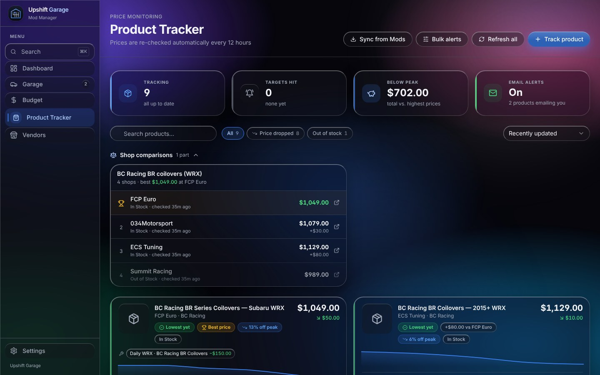
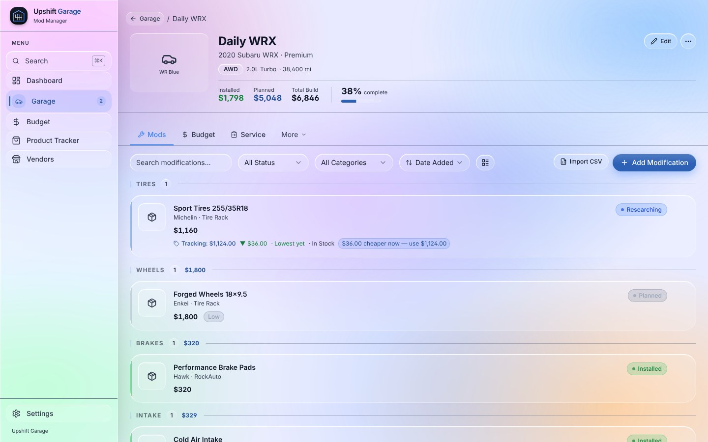
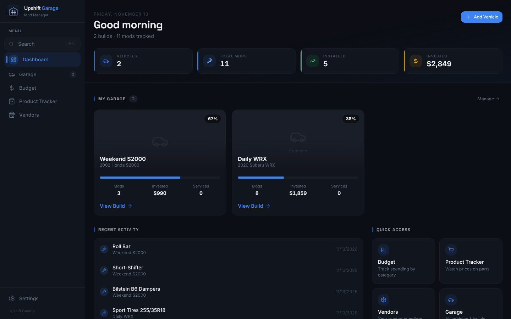
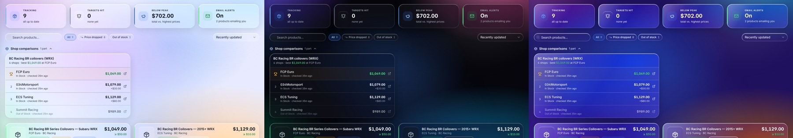

<p align="center">
  
</p>

<h1 align="center">Upshift Garage</h1>

<p align="center">
  <b>Plan, track and budget your car build.</b><br>
  A local-first vehicle modification manager — track mods, watch prices, log maintenance, and keep it all on your own machine or your own server.
</p>

<p align="center">
  
  <a href="../../actions/workflows/ci.yml"></a>
</p>

<p align="center">
  
</p>

> **Formerly BuildVerse.** The app was renamed to Upshift Garage in v1.15.0. Nothing was lost in the move: the desktop app keeps its original `BuildVerse` data folder, and the repository, Docker image path and database file names are unchanged, so existing installs and servers keep working. Details in the [release notes](../../releases/latest).

Runs **100% locally by default** — no cloud, no accounts, no internet required. Optionally self-host it (Docker) so your desktop app, phone and friends all share one live garage.

---

## Download

Get the latest build from **[Releases](../../releases/latest)**. No Node.js, no prerequisites — everything is bundled.

| Platform | Download |
|---|---|
| **Windows 10/11** | `UpshiftGarage-Setup-x.x.x.exe` (installer) or `UpshiftGarage-x.x.x-Portable.exe` |
| **macOS — Homebrew** (recommended) | `brew tap AnthonyKPhoto/buildverse https://github.com/AnthonyKPhoto/buildverse && brew install --cask upshift-garage` |
| **macOS — Apple Silicon** (M1 and newer) | `UpshiftGarage-x.x.x-mac-arm64.dmg` |
| **macOS — Intel** | `UpshiftGarage-x.x.x-mac-x64.dmg` |
| **Linux** (64-bit, glibc) | `UpshiftGarage-x.x.x.AppImage` or `upshift-garage_x.x.x_amd64.deb` |
| **Docker / self-hosted** | `ghcr.io/anthonykphoto/buildverse` — see [Self-hosting](#self-hosting-with-docker) |

<details>
<summary><b>First-launch notes (Windows, macOS, Linux)</b></summary>

**Windows** — SmartScreen may warn because the app isn't code-signed yet: **More info → Run anyway**. Installs per-user, no admin rights needed.

**macOS** — the app isn't notarized (that requires a paid Apple Developer account), so a downloaded `.dmg` is blocked on first launch. **The easy fix is Homebrew**, which installs it ready to run and updates it with the rest of your apps:
```bash
brew tap AnthonyKPhoto/buildverse https://github.com/AnthonyKPhoto/buildverse
brew install --cask upshift-garage
brew upgrade --cask upshift-garage   # later, to update
```
Prefer the `.dmg`? Open the `.dmg`, drag **Upshift Garage** into *Applications*, open it once, then go to **System Settings → Privacy & Security → Open Anyway**. Or from Terminal:
```bash
xattr -cr "/Applications/Upshift Garage.app"
```
macOS builds don't auto-update; the app shows a notice when a new release is available.

**Linux**
```bash
# AppImage — runs on most distros, no install
chmod +x UpshiftGarage-x.x.x.AppImage && ./UpshiftGarage-x.x.x.AppImage

# Debian / Ubuntu
sudo apt install ./upshift-garage_x.x.x_amd64.deb
```
</details>

On first launch a small demo garage (a 2002 Honda S2000 with a sample build) is created so you can look around — remove it any time from **Settings → Data & Backup**.

---

## Features

- **Garage** — multiple vehicles with full specs, photos, VIN decode and recall lookup
- **Modification tracker** — Researching → Planned → Ordered → Purchased → Installed, with priorities, dependencies, install dates/mileage, labor cost and DIY tracking
- **Build planner & Kanban** — see every mod across every vehicle, grouped and filterable
- **Budget planner** — planned vs. actual spend per category, with charts
- **Product tracker** *(new look in 1.15)* — paste any product page and watch the price over time
  - background checks, price history sparklines, target-price alerts
  - optional **email alerts** (target reached, big drops, back in stock) as a single digest
  - **shop comparison** — track the same part at several shops; the cheapest in-stock one is flagged
  - **linked to your mods** — a mod's product link is matched to its tracked price
  - **sync by car** — pick which vehicles' mod links to import; anything already purchased, installed or removed is skipped, and products are **dropped automatically** on the next price check once their mod is bought
  - **delete all tracking** in one click
- **Maintenance logs** — service history with next-due tracking, plus [LubeLogger](https://lubelogger.com) import
- **Build sheet PDF** and a shareable **build card**
- **Files & tune logs** — attach documents, receipts, and dyno/tune logs to each vehicle
- **Scheduled backups** — consistent database snapshots on a schedule, with one-click download and (on a server) restore
- **Make it yours** — accent colour, interface size, currency, date format, and three frosted-glass themes with your own background picture ([see below](#appearance))
- **Multi-user server mode** — real accounts, admin-managed, per-vehicle edit permissions

<p align="center">
  
  
</p>

### Appearance

Settings → General has a floating switcher for four materials — **Classic** (solid, the original look), **Light Frosted**, **Dark Frosted** and **Clear Crystal** — plus sliders for glass opacity, blur, saturation, edge shine, shadow depth and corner roundness, and an option to use **your own picture** as the background. Pictures are resized in your browser and stay on that device; nothing is uploaded.

<p align="center">
  
</p>

---

## Self-hosting with Docker

Running Upshift Garage as a server makes it the single source of truth: the desktop app (in *Connect to Server* mode), your phone's browser and other people's logins all use the same live database — nothing to sync or merge.

### 1. Put HTTPS in front of it

Use a reverse proxy you already run (Caddy, nginx, Nginx Proxy Manager, a Cloudflare Tunnel…) pointing at the container's port. `docker-compose.yml` publishes the port on **`127.0.0.1:3456`** by default so it isn't exposed to your network by accident; if your proxy runs on another machine, change the mapping to `"3456:3000"`.

### 2. Configure

Copy `.env.example` to `.env` **next to `docker-compose.yml`** and fill it in (compose loads it automatically):

| Variable | Required | Purpose |
|---|---|---|
| `AUTH_SESSION_SECRET` | **Yes** | Any long random string (`node -e "console.log(require('crypto').randomBytes(32).toString('hex'))"`). **Setting it turns login on. Without it the server has no login at all.** |
| `APP_URL` | **Strongly recommended** | Your public URL, e.g. `https://garage.example.com`. Used for links in reset/welcome emails so they can't be forged via the `Host` header. |
| `ADMIN_USERNAME` / `ADMIN_PASSWORD_HASH` | Optional | Pre-create the first admin (`node scripts/hash-password.js "your-password"`). If unset, the first visitor to the site creates the admin account — do that promptly after first boot. |

> Changed `.env` on a running server? Run `docker compose up -d` (a plain restart doesn't re-read it) and check `/api/health` — `"mode":"server"` confirms login is on.

### 3. Start it

```bash
docker compose up -d
```

The schema is applied automatically on every boot, and the previous database is copied to `buildverse.db.pre-update.bak` first, so upgrades are reversible.

### 4. Update

Watchtower in `docker-compose.yml` checks for new images hourly. It needs the Docker socket mounted, which is root-equivalent on the host — delete that service if you'd rather update by hand:
```bash
docker compose pull && docker compose up -d
```

### Accounts and permissions

Everyone can **view** the shared garage. **Settings → Access & Sync → Users** (admin) creates accounts — give a password, or give an email and Upshift Garage sends a temporary one (configure SMTP under the same tab or in **Settings → Price Alerts**). By default a member can edit vehicles they created; an admin can grant edit access to others under **Vehicle Access**. Admins can edit everything.

### Backups

Automatic backups are on by default (daily, newest 7 kept) and written to `/data/backups` on your volume. Manage them in **Settings → Data & Backup**: download, delete, or **restore** (admin password required; a safety copy of the current data is taken first).

<details>
<summary><b>Bringing in vehicles from separate local installs</b></summary>

1. On each source install: **Settings → Data & Backup → Export Data** (JSON) or **Export Transfer Pack** (.zip — use this if you have uploaded files or tune logs).
2. On the server, signed in as the person who should own those vehicles: **Import Data** (JSON) or **Add Vehicles from Transfer Pack** (.zip). Both *add* vehicles and never touch anyone else's data.

**Settings → Access & Sync → Server Data** (admin) is different: it *replaces the entire server database* from a `.db` backup or transfer pack. Use it once, for your own primary migration.
</details>

---

## Security

Server mode is built to be reachable from the internet: signed, expiring session cookies; scrypt password hashing; rate-limited sign-in and password reset; per-vehicle edit permissions re-checked against the database; SSRF-guarded product scraping; and hardened file and import handling. See **[SECURITY.md](SECURITY.md)** for the details and how to report a problem.

---

## Development

Requires [Node.js 22.19+](https://nodejs.org) and Git.

```bash
git clone https://github.com/AnthonyKPhoto/buildverse.git
cd buildverse
npm install
npm run setup        # generate Prisma client, create the database, load demo data
npm run dev          # http://localhost:3000
npm run electron:dev # same, in the desktop window
```

| Command | What it does |
|---|---|
| `npm run dev` | Next.js dev server (browser) |
| `npm run build` / `npm start` | Production build / run it |
| `npm run setup` | Prisma client + schema push + demo data |
| `npm run db:studio` / `db:reset` | Visual DB editor / wipe and re-seed |
| `npm run electron:dev` | Dev server + Electron window |
| `npm run package:win` / `package:mac` / `package:linux` | Build that platform's installer locally (each must run on its own OS) |
| `npm run gen-icons` | Regenerate every logo/icon asset from `public/logo.svg` |

### Where data lives

| Mode | Location |
|---|---|
| Browser / dev | `prisma/dev.db` |
| Windows app | `%APPDATA%\BuildVerse\` |
| macOS app | `~/Library/Application Support/BuildVerse/` |
| Linux app | `~/.config/BuildVerse/` |
| Docker | the `/data` volume (`buildverse.db`, `vehicle-files/`, `tune-logs/`, `backups/`) |

The desktop folder keeps its original name deliberately — see the note at the top.

### Publishing a release

1. Update `RELEASE_NOTES.md` (becomes the top of the GitHub release page) and add an entry to `CHANGELOG.md`.
2. `npm version minor --no-git-tag-version` (or `patch`/`major`), commit, push to `main`.
3. Tag and push: `git tag vX.Y.Z && git push origin vX.Y.Z` — or, where tags can't be pushed, run **Build & Release** and **Docker** from the Actions tab (*Run workflow*, version `X.Y.Z`, branch `main`).

That runs **Build & Release** (Windows, macOS ×2, Linux → one GitHub Release; then it updates the Homebrew cask in `Casks/`) and **Docker** (publishes `ghcr.io/anthonykphoto/buildverse:X.Y.Z` and `:latest`). No extra secrets are needed. Code signing / macOS notarization are optional — see the comments in `electron-builder.yml`.

### Tech stack

Next.js 14 (App Router) · React 18 · TypeScript · Tailwind CSS · Radix UI · Recharts · Prisma + SQLite · Electron 33 · Cheerio (scraping) · jose + scrypt (auth) · Docker · GitHub Actions.

### Project layout

```
.github/            workflows (CI, release, docker) and issue / PR templates
docs/               screenshots and the repository social-preview image
electron/           desktop shell: window, tray, bundled-server lifecycle
prisma/             schema and demo-data seed
scripts/            Docker init, icon generator, password tools, packaging hooks
src/app/            pages and API routes (garage, builds, budget, products, maintenance, vendors, settings, auth…)
src/components/     UI: layout, vehicles, modifications, products, settings, ui primitives
src/lib/            auth, scraper, price tracker, backups, preferences, helpers
```

---

## Supported shops (Product Tracker)

ECS Tuning · FCP Euro · 034Motorsport · Integrated Engineering · APR · Unitronic · CTS Turbo · UROTuning · BMP Tuning · AutoZone · RockAuto · Amazon · Tire Rack — and most shops that publish schema.org / Open Graph product data. Some shops block automated checks.

---

## Contributing & feedback

Bug reports and ideas are welcome — use the [issue templates](../../issues/new/choose). For security problems please follow [SECURITY.md](SECURITY.md) instead of opening a public issue.
